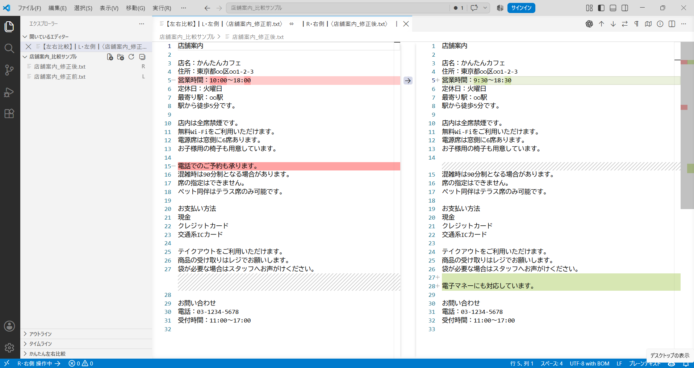
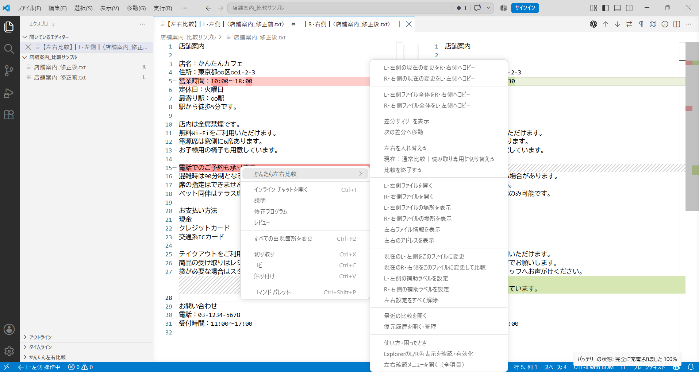
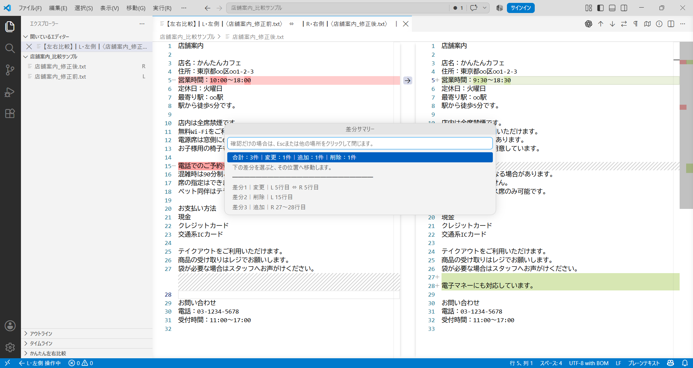

# Easy Left Right Diff

A free VS Code/Cursor extension for comparing two files clearly as **L / Left** and **R / Right**.

It keeps the standard VS Code diff editor while making the two real files, their locations, copy direction, and the file being changed easier to understand.

**Current version: 1.0.7**  
Verified on Windows Visual Studio Code and Cursor.

## Useful when you want to

- Compare files with the same or similar names
- Keep Left and Right clear while reviewing differences
- Copy only the current changed block in either direction
- Copy a whole file in either direction
- Keep local recovery history before changes
- Continue using the standard VS Code diff editor

## Screenshots

### Comparison overview

### Context menu

### Difference Summary

## Quick start

1. Right-click the first file and choose `Easy Left Right Diff` → set it as L / Left.
2. Right-click the second file and choose the action that sets it as R / Right and starts comparison.
3. Confirm both file names and locations, then start a normal or read-only comparison.

When two files are easy to select together, you can also select both in Explorer and start the two-file comparison command.

## Main features

- Clear L / Left and R / Right file assignment
- Standard VS Code diff editor
- File-location and full-path confirmation for same-name files
- Blue L and purple R helper decorations
- Active-side display
- Bidirectional changed-block copy
- Bidirectional whole-file copy
- Restore the state recorded before the last copy
- Difference Summary with direct navigation
- Swap Left and Right
- Normal and read-only comparison modes
- Recent comparisons
- Local recovery history
- Safety checks for unsaved changes, Auto Save, Git status, file size, and encoding
- Automatic L/R clearing when the managed comparison tab closes

## Copy and save

Before a copy runs, the extension shows the direction, such as `L / Left → R / Right`, and the real file that will be changed.

A copied result may remain unsaved. Save it with the extension's save action, `Ctrl + S`, or the normal VS Code/Cursor save command. If Auto Save is enabled, the change may be saved automatically.

## Recovery history

Before the extension changes file contents through copy, save, or restore operations, it stores the previous content in local recovery history.

You can:

- Compare a recovery entry with current content
- Restore a recovery entry
- Save a recovery entry as another file
- Delete one entry
- Delete all entries

Limits:

- Three newest entries per file
- Thirty entries total
- 60 MB total

Recovery history is not transmitted externally, but it is not encrypted on local storage.

## Safety behavior

- Copy direction and target file are confirmed before changes.
- Copy stops when one safe target change cannot be identified.
- If a compared file changes outside the current operation, stale diff information is not used for copying.
- Files over 5 MB show a warning.
- Extension copy is disabled over 20 MB or 200,000 lines.
- Files judged to be non-UTF-8 default to read-only behavior.
- Binary files are not supported.

## Usage and troubleshooting

Open `Usage and Troubleshooting` from the L/R confirmation view or Command Palette.

See [Detailed usage guide](https://github.com/kantan-tools/easy-left-right-diff/blob/main/USAGE.en.md) for detailed instructions.

## Privacy

- File contents and diffs are not transmitted externally.
- No telemetry.
- No AI service.
- No account registration.
- Recent comparisons and recovery history are stored locally.

See [Privacy information](https://github.com/kantan-tools/easy-left-right-diff/blob/main/PRIVACY.md) for details.

## Checked environments

- Visual Studio Code: verified on Windows
- Cursor: verified on Windows
- macOS: not yet verified
- Linux: not yet verified

## Support

Bugs and feature requests:  
https://github.com/kantan-tools/easy-left-right-diff/issues

For security issues, do not post unresolved vulnerability details publicly. Report them privately here:  
https://github.com/kantan-tools/easy-left-right-diff/security/advisories/new

## License

MIT License  
Copyright (c) 2026 kantan-tools
