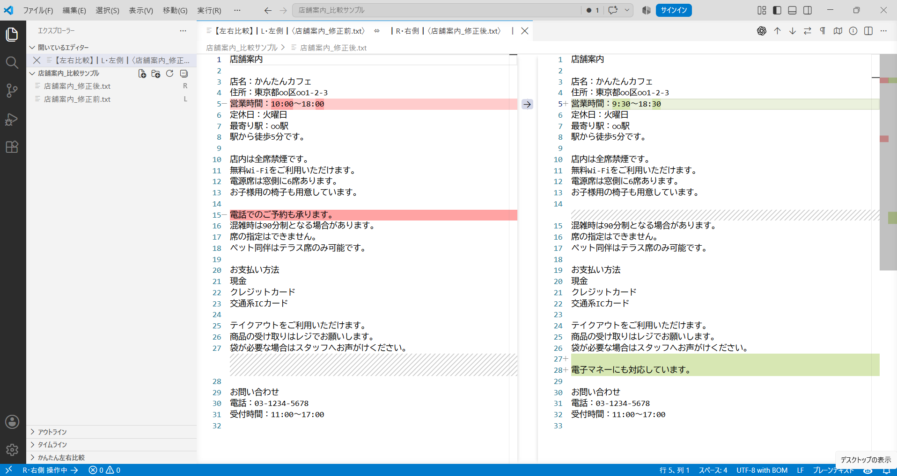
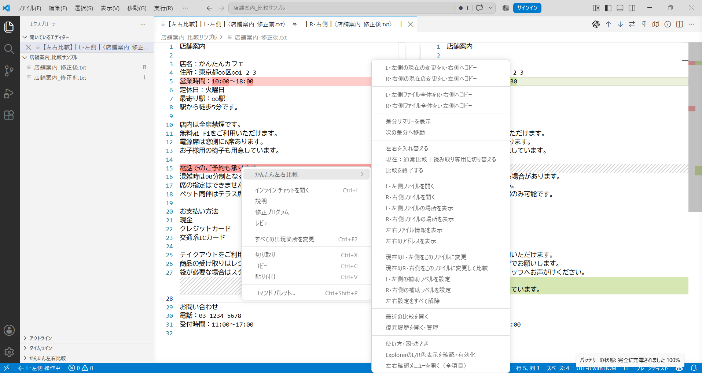
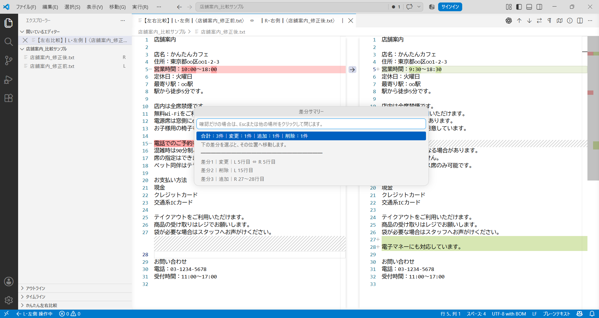

# かんたん左右ファイル比較

2つのファイルを **L・左側** と **R・右側** として分かりやすく比較できる、VS Code／Cursor向けの無料拡張機能です。

VS Code標準の差分画面をそのまま使いながら、左右のファイル、保存場所、コピー方向、変更されるファイルを確認しやすくします。

**現在のバージョン：1.0.7**  
Windows版 Visual Studio Code／Cursor で動作確認しています。

## こんなときに便利です

- 同じ名前や似た名前のファイルを見比べたい
- どちらが左／右か迷わず比較したい
- 必要な変更箇所だけを反対側へコピーしたい
- ファイル全体を反対側へコピーしたい
- コピー前の状態を復元できるようにしておきたい
- VS Code標準の差分表示をそのまま使いたい

## 画面イメージ

### 左右比較

### 右クリックメニュー

### 差分サマリー

## 基本の使い方

1. 1つ目のファイルを右クリックし、`かんたん左右比較` → `このファイルをL・左側に設定`を選びます。
2. 2つ目のファイルを右クリックし、`かんたん左右比較` → `このファイルをR・右側にして比較`を選びます。
3. L・Rのファイル名と場所を確認し、通常比較または読み取り専用で開始します。

同じフォルダーなどで2ファイルを選びやすい場合は、`Ctrl`を押しながら2ファイルを選択し、`選択した2ファイルを左右比較`から開始することもできます。

## 主な機能

- L・左側／R・右側を明示したファイル比較
- VS Code標準差分画面の利用
- 同名ファイルの保存場所・完全なアドレス確認
- Lは青、Rは紫の補助表示
- 現在操作している側の表示
- 変更箇所の双方向コピー
- ファイル全体の双方向コピー
- コピー前の状態へ戻す機能
- 差分サマリーと差分位置への移動
- 左右の入れ替え
- 通常比較／読み取り専用比較の切り替え
- 最近の比較履歴
- 復元履歴
- 未保存・自動保存・Git管理状態・ファイルサイズ・文字コードの安全確認
- 比較タブを閉じたときのL・R自動解除

## コピーと保存

変更箇所やファイル全体をコピーするときは、`L・左側 → R・右側` のようにコピー方向と書き換わるファイルを確認してから実行します。

コピー後は未保存状態になる場合があります。必要に応じて本拡張機能の保存ボタン、`Ctrl + S`、またはVS Code／Cursorの通常の保存操作で保存してください。自動保存が有効な場合は、自動的に保存されることがあります。

## 復元履歴

本拡張機能がコピー・保存・復元でファイル内容を変更する前に、その時点の内容をローカルへ復元履歴として保存します。

復元履歴から次の操作ができます。

- 現在の内容と見比べる
- 履歴の内容へ戻す
- 別ファイルとして保存する
- 1件ずつ削除する
- すべて削除する

保持上限は次のとおりです。

- 同じファイル：最新3件
- 全ファイル合計：最大30件
- 合計容量：最大60MB

復元履歴は外部へ送信されませんが、ローカル保存時に暗号化されません。

## 安全のための動作

- コピー方向と対象ファイルを確認してから変更します。
- 対象の変更箇所を安全に特定できない場合はコピーを停止します。
- 比較中に別の操作でファイル内容が変わった場合は、古い差分情報を使わずコピーを停止します。
- 5MBを超えるファイルでは警告します。
- 20MB超または20万行超では、本拡張機能によるコピーを無効にします。
- UTF-8以外と判断したファイルは読み取り専用を基本とします。
- バイナリファイルは対象外です。

## 使い方・困ったとき

左右確認ビューまたはコマンドパレットから `使い方・困ったとき` を開けます。

より詳しい操作方法は [詳しい使い方](https://github.com/kantan-tools/easy-left-right-diff/blob/main/USAGE.md) をご覧ください。

## プライバシー

- ファイル内容や差分を外部へ送信しません。
- テレメトリを使用しません。
- AIサービスを使用しません。
- アカウント登録はありません。
- 最近の比較と復元履歴はローカルへ保存します。

詳しくは [プライバシーについて](https://github.com/kantan-tools/easy-left-right-diff/blob/main/PRIVACY.md) をご覧ください。

## 対応環境

- Visual Studio Code：Windowsで確認済み
- Cursor：Windowsで確認済み
- macOS：未確認
- Linux：未確認

## サポート

通常の不具合・要望：  
https://github.com/kantan-tools/easy-left-right-diff/issues

セキュリティ上の問題は公開Issueへ詳細を書かず、こちらから非公開で報告してください。  
https://github.com/kantan-tools/easy-left-right-diff/security/advisories/new

## ライセンス

MIT License  
Copyright (c) 2026 kantan-tools
